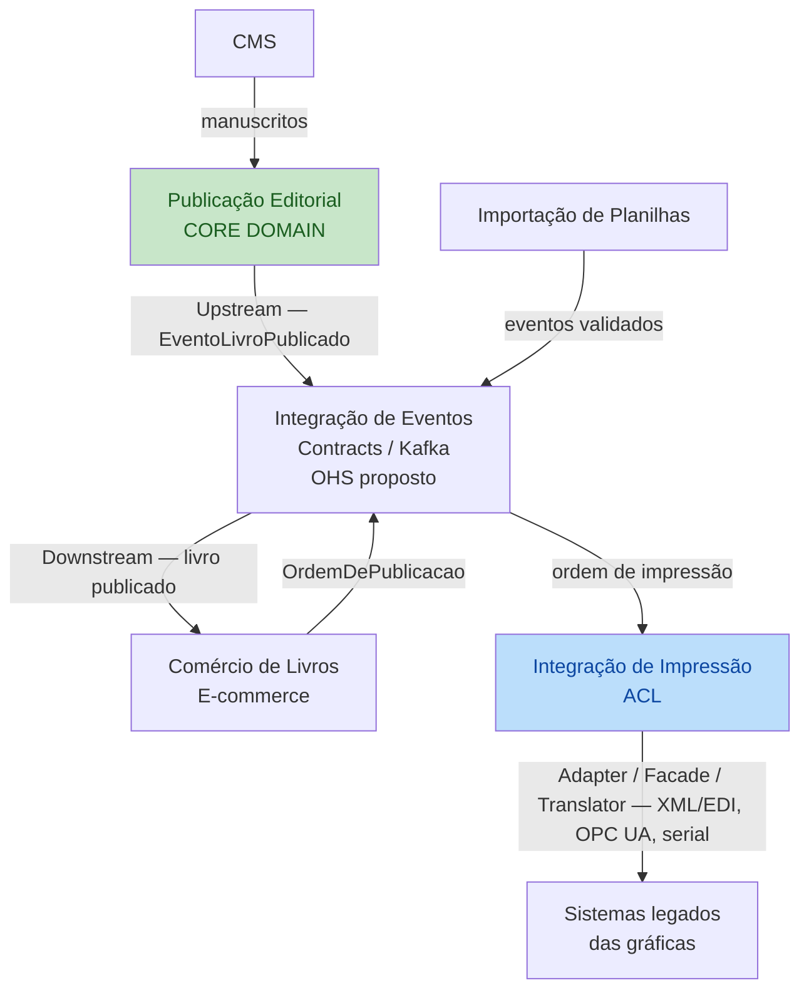

# Mapa de Contextos — Agile Dead Trees

Fonte: consolidado da Sprint 3 (arquivo `docs/sprints/sprint-3.pdf`).

## Diagrama

## Contextos delimitados

| Contexto | Responsabilidade |
|---|---|
| Publicação Editorial | Regras de validação e publicação dos livros — **Core Domain**. |
| Comércio de Livros | Disponibilização dos livros para venda e registro dos pedidos. |
| Importação de Planilhas | Leitura, validação e transformação dos dados das planilhas em eventos. |
| Integração de Impressão | Encaminhamento das ordens de impressão aos sistemas legados das gráficas. |
| Integração e Distribuição de Eventos | Contratos e Apache Kafka para comunicação entre os sistemas. |

## Relacionamentos

- **Upstream/Downstream:** Publicação Editorial é *upstream* em relação ao Comércio de Livros, pois informa que o livro foi publicado; o Comércio é *downstream* e usa essa informação para vender. No fluxo de impressão, o Comércio fornece a ordem de impressão e a Integração de Impressão a adapta para a gráfica de destino.
- **Anti-Corruption Layer (ACL):** localizada no contexto de Integração de Impressão. Protege os sistemas modernos das diferenças de formatos, protocolos e modelos de dados dos sistemas legados, usando **Adapter, Facade e Translator** (ADR-003).
- **Open Host Service (OHS):** propõe contratos de eventos claros e estáveis para os consumidores, sobre o Kafka já adotado (ADR-002). A formalização dos contratos ainda está em andamento.

## Decisão relacionada

Os limites acima foram registrados na [ADR-008](../adr/ADR-008.md), que complementa as decisões anteriores sem alterar o uso de Kafka, da ACL e dos padrões Adapter, Facade, Translator, Factory Method e Strategy.
